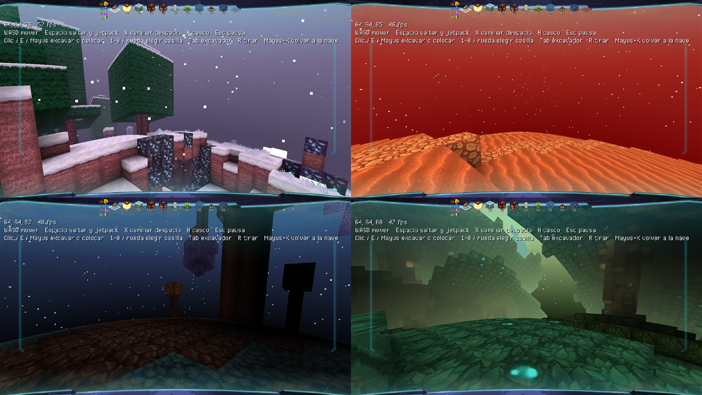
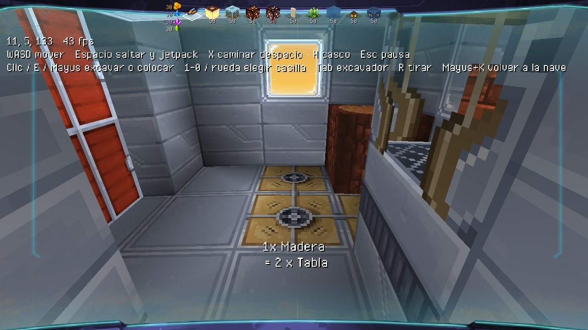
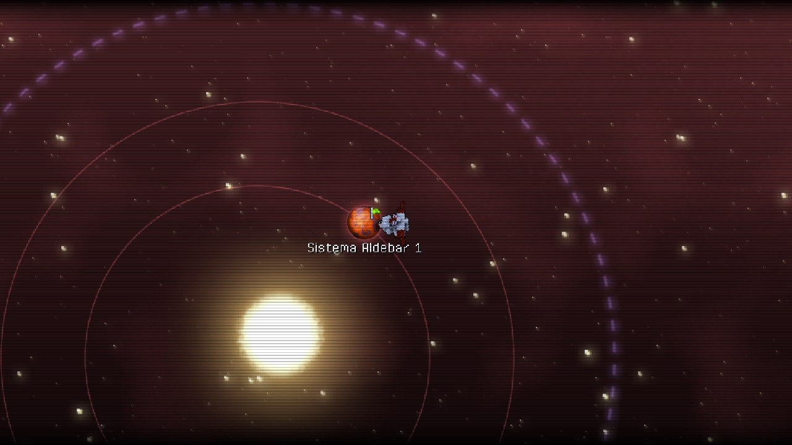

# Galaxy 55 — offline version (native Windows port)

**English** · [Español](#español)



**Galaxy 55** was a Flash web game (2012) by **Motion Twin**: space exploration, randomly generated planets and a 3D block-building and crafting system.
It was shut down and its server no longer exists. This project ports it to a **native Windows desktop application**
(Haxe 4 + Heaps + HashLink), with no Flash and no server, starting from the code Motion Twin published in
[WebGamesArchives](https://github.com/motion-twin/WebGamesArchives). The goal is to stay faithful to the original; anything we add is labelled as such.

> Work in progress, not a final version.

## Where to find things

| I want to… | Look at |
|---|---|
| **Play without compiling** | [pre-release v0.2](../../releases/tag/v0.2): download the zip, unzip it, run `jugar.bat` |
| **Controls and how to build** | [`port/README.md`](port/README.md) |
| **See or report bugs** | [`BUGS.md`](BUGS.md) (known bugs); to report a new one, open an *issue* or message me |
| **See what is missing** | [`TODO.md`](TODO.md) (to-do list) |
| **See what changed** | [`CHANGELOG.en.md`](CHANGELOG.en.md) |
| **Developer notes** | [`port/RESUMEN.md`](port/RESUMEN.md) (Spanish) |
| **The Flash version (archived)** | [`docs/flash/README_flash.md`](docs/flash/README_flash.md) (Spanish, English summary at the end), branch [`flash`](../../tree/flash), tag [`flash-version`](../../tree/flash-version) |

## Play in 3 steps

1. Download the zip from the [pre-release v0.2](../../releases/tag/v0.2) and **unzip everything** (keep all its folders).
2. Check that there is a **`res/`** folder next to `galaxy55.hl` (with `texture.png`, `lazer.png`… inside). If you see loose files named
   like `res\texture.png` instead, extraction failed: unzip again with a different program. (Symptom: `Can't read res/texture.png`.)
3. Windows: double-click `jugar.bat`. **Linux / macOS (not tested by us):** download the `galaxy55-offline-v0.2-linux-mac.zip` from the release,
   install [HashLink](https://github.com/HaxeFoundation/hashlink) (`brew install hashlink` on macOS) and run `sh jugar.sh`. (A player got it running on Linux; tell us how it goes.)
   The language (Spanish, English, French) is changed in Options.

## What works today



Start menu, saved games, planets identical to the original ones (verified by hash against Flash), digging and placing blocks, jetpack,
creative mode (our addition), the ship with its teleporter, doors, synthesizer with the original recipes and the on-board computer,
and the **star map** (sector, solar systems, scanning and landing).



Still missing: the shop, the hangar, sound, flowing water, and the exact travel animations of the star map. See [`TODO.md`](TODO.md).

## Known bugs (summary)

Full numbered list in [`BUGS.md`](BUGS.md). The main ones:
- Deleting a saved game from the menu does not work.
- Lighting errors on non-square blocks; plain white blocks and odd spruce leaves in the winter biome; planet curvature too strong.
- No particles when breaking a block; hanging things and ground plants cannot be broken.
- On the ship: the cascade source block cannot be removed and the synthesizer does not use up the blocks placed in its area.
- Star map: entering/leaving a system and landing are a simple fade, not the original animations.
- Water does not flow. The shop, the hangar and sound are missing.

**Found another one?** Tell me in a GitHub *issue* or on Discord, with what you were doing and a screenshot if you can.

## Repository layout

```
port/           THE NATIVE PORT (active work)
  game/         the game        explore/  star map     shim/  flash.* compatibility layer for the original generators
  headless/     verification    dev/      test bench   LEEME.md, RESUMEN.md, RELEASE.md, jugar.bat
docs/flash/     documentation of the Flash version (README, changelog, to-do of that time)
docs/           research notes (sources, Twinpedia, Discord);  docs/img/  screenshots
src/ libs/ stubs/ tools/ data/ release/ client*.hxml build.*   original (Motion Twin) code and the Flash version
```

## License and credits

The original code, graphics and data belong to **Motion Twin** and were published under
[CC BY-NC-SA 4.0](https://creativecommons.org/licenses/by-nc-sa/4.0/). This modified version is shared under the **same license**:
non-commercial, with credit to Motion Twin, share-alike. It is not affiliated with or endorsed by Motion Twin.
Thanks to the Eternaltwin community for preserving documentation and screenshots.
Thanks to **Sekhmet** for detailed bug reports, testing on Linux, and memories of how the original game worked (water, lava, cascades).

---

## Español

**Galaxy 55** fue un juego web de Flash (2012) de **Motion Twin**: exploración espacial, planetas generados al azar y
un sistema de bloques con crafteo en 3D. Se cerró y su servidor ya no existe. Este proyecto lo porta a una
**aplicación de escritorio nativa para Windows** (Haxe 4 + Heaps + HashLink), sin Flash y sin servidor, partiendo del
código que Motion Twin publicó en [WebGamesArchives](https://github.com/motion-twin/WebGamesArchives).
El objetivo es ser fiel al original; lo que añadimos está marcado como tal.

> Es un trabajo en curso, no una versión final.

### Dónde está cada cosa

| Quiero… | Mira |
|---|---|
| **Jugar sin compilar** | [pre-release v0.2](../../releases/tag/v0.2): descarga el zip, descomprímelo y abre `jugar.bat` |
| **Controles y cómo compilar** | [`port/LEEME.md`](port/LEEME.md) |
| **Ver o avisar de errores** | [`ERRORES.md`](ERRORES.md); para avisar de uno nuevo, abre un *issue* o escríbeme |
| **Saber qué falta por hacer** | [`PENDIENTES.md`](PENDIENTES.md) |
| **Ver qué cambió** | [`CHANGELOG.md`](CHANGELOG.md) |
| **Notas técnicas del desarrollo** | [`port/RESUMEN.md`](port/RESUMEN.md) |
| **La versión Flash (archivada)** | [`docs/flash/README_flash.md`](docs/flash/README_flash.md), rama [`flash`](../../tree/flash), etiqueta [`flash-version`](../../tree/flash-version) |

### Jugar en 3 pasos

1. Descarga el zip de la [pre-release v0.2](../../releases/tag/v0.2) y **descomprímelo entero** (con todas sus carpetas).
2. Comprueba que hay una carpeta **`res/`** junto a `galaxy55.hl` (con `texture.png`, `lazer.png`… dentro). Si en vez de eso ves
   archivos sueltos llamados `res\texture.png`, la extracción falló: vuelve a descomprimir con otro programa. (Síntoma: `Can't read res/texture.png`.)
3. Windows: doble clic en `jugar.bat`. **Linux / macOS (sin probar por nosotros):** descarga `galaxy55-offline-v0.2-linux-mac.zip` de la release,
   instala [HashLink](https://github.com/HaxeFoundation/hashlink) (`brew install hashlink` en macOS) y ejecuta `sh jugar.sh`. (Un jugador lo ha hecho funcionar en Linux; cuéntanos qué tal.)
   El idioma (español, inglés, francés) se cambia en Opciones.

### Qué funciona hoy

Menú de inicio, partidas guardadas, planetas idénticos a los del original (verificado por hash contra Flash),
excavar y colocar, jetpack, modo creativo (añadido nuestro), la nave con teletransportador, puertas, sintetizador con las
recetas del original y ordenador de a bordo, y el **mapa de estrellas** (sector, sistemas solares, escaneo y aterrizaje).
Faltan la tienda, el hangar, el sonido, el agua que fluye y las animaciones exactas de viaje del mapa; ver [`PENDIENTES.md`](PENDIENTES.md).

### Errores conocidos (resumen)

Lista completa y numerada en [`ERRORES.md`](ERRORES.md). Los principales:
- Borrar una partida desde el menú no funciona.
- Fallos de luz en bloques no cuadrados; bloques blancos y hojas de abeto raras en invierno; curvatura del planeta exagerada.
- Al romper un bloque no hay partículas; no se pueden romper las cosas colgadas ni las plantas del suelo.
- En la nave: no se puede quitar la fuente de cascada y el sintetizador no gasta los bloques puestos.
- Mapa de estrellas: entrada, salida y aterrizaje son un fundido simple, no las animaciones del original.
- El agua no fluye. Faltan la tienda, el hangar y el sonido.

**¿Has encontrado otro?** Cuéntalo en un *issue* de GitHub o por Discord, con lo que hacías y una captura si puedes.

### Estructura del repositorio

Ver el esquema en inglés más arriba: `port/` es el port nativo (activo); `docs/flash/` la documentación de la versión Flash;
`docs/` las notas de investigación y `docs/img/` las capturas; el resto (`src/`, `libs/`, `release/`…) es el código original y la versión Flash.

### Licencia y créditos

El código, los gráficos y los datos originales son de **Motion Twin**, publicados bajo
[CC BY-NC-SA 4.0](https://creativecommons.org/licenses/by-nc-sa/4.0/). Esta versión modificada se comparte bajo la
**misma licencia**: sin uso comercial, con atribución a Motion Twin y compartiendo igual. No está afiliada ni respaldada
por Motion Twin. Gracias a la comunidad de Eternaltwin por conservar documentación y capturas.
Gracias a **Sekhmet** por sus reportes de errores detallados, las pruebas en Linux y sus recuerdos de cómo funcionaba el juego original (agua, lava, cascadas).
